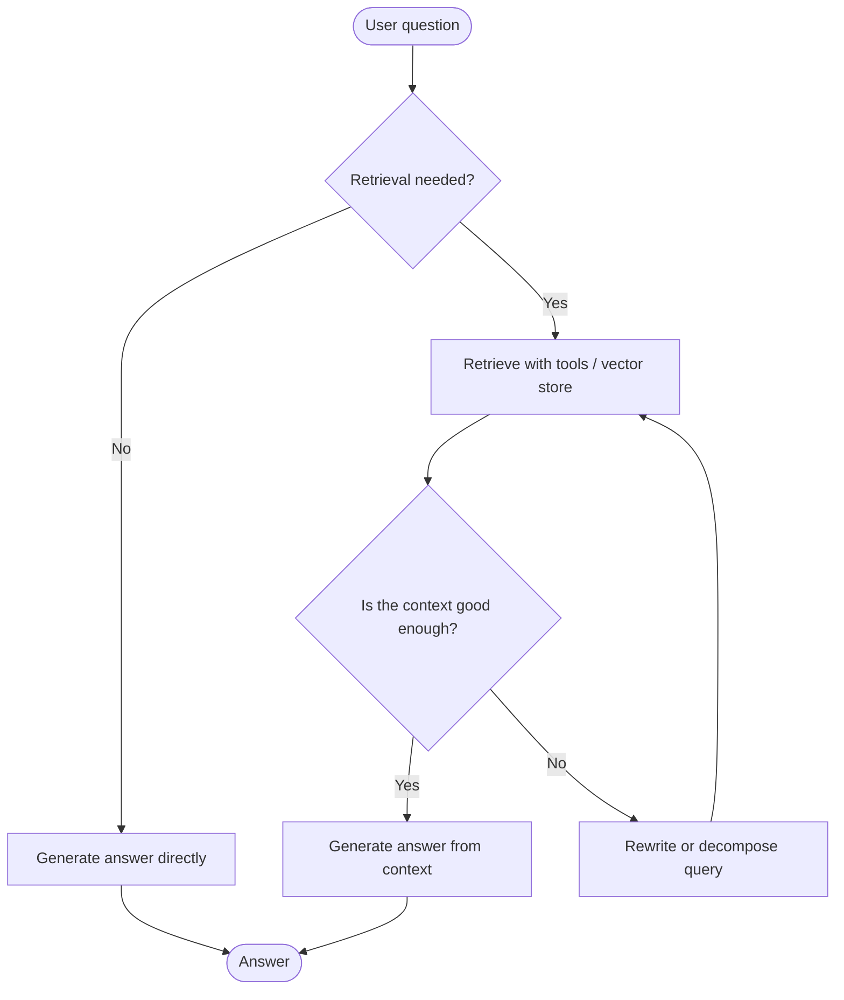
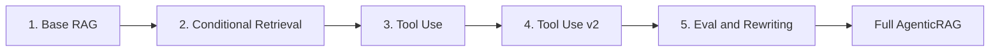

<div align="center">

#  AgenticRAG: Building Autonomous Retrieval-Augmented Generation Pipelines

**A step-by-step journey from a fixed retrieve-and-generate pipeline to an autonomous, graph-based agent that decides when, where and how to retrieve.**


</div>

---

##  About

This repository contains a **step-by-step implementation of Agentic RAG systems** using Python and Jupyter Notebooks. It shows the evolution from a traditional fixed retrieval pipeline to an **autonomous, graph-based agent workflow** capable of dynamic decision-making, tool execution, query evaluation and rewriting.

Each notebook adds one new capability on top of the last, so you can see exactly what "agentic" adds to a plain RAG system.

---

### Key Differences

* **Pipeline Execution Structure**:
  * **Basic RAG**: Follows a **fixed, linear pipeline**. Every user query automatically triggers a vector database search to fetch context, combines that context with a prompt, and sends it to the LLM to generate an answer.
  * **Agentic RAG**: Replaces static execution with a **dynamic workflow** (often structured as a state graph using frameworks like LangGraph) with conditional branching.

* **Dynamic Reasoning vs. Static Execution**:
  * **Basic RAG**: Cannot evaluate whether a query actually requires external data or if retrieval was successful.
  * **Agentic RAG**: Employs **autonomous agents** that use reasoning capabilities to make real-time decisions about if, where, and how to execute retrieval actions.

* **Architectural Implementation**:
  * **Basic RAG**: Consists of a simple chunk-and-embed retriever, prompt template, and LLM call.
  * **Agentic RAG**: Requires **state definitions** (tracking question, state flags, and retrieved documents), agent function nodes, and **conditional edge logic** that routes execution dynamically based on query evaluation.
---

##  Research Paper

This project is inspired by the survey paper on Agentic RAG:

> **Agentic Retrieval-Augmented Generation: A Survey on Agentic RAG**
> Aditi Singh, Abul Ehtesham, Saket Kumar, Tala Talaei Khoei
> arXiv:2501.09136 [cs.AI], January 2025

| Resource | Link |
| --- | --- |
|  Paper (abstract) | [arxiv.org/abs/2501.09136](https://arxiv.org/abs/2501.09136) |
|  Paper (PDF) | [arxiv.org/pdf/2501.09136](https://arxiv.org/pdf/2501.09136) |
|  Authors' companion repo | [asinghcsu/AgenticRAG-Survey](https://github.com/asinghcsu/AgenticRAG-Survey) |

**What the paper is about:** traditional RAG systems rely on static workflows and struggle with multi-step reasoning and complex tasks. The survey describes how embedding autonomous agents into the RAG pipeline fixes this. These agents use four agentic design patterns:

| Pattern | Idea |
| --- | --- |
|  **Reflection** | The system critiques and corrects its own retrieval and answers |
|  **Planning** | Complex questions are broken into smaller sub-tasks |
|  **Tool use** | The agent calls tools, APIs and data sources as needed |
|  **Multi-agent collaboration** | Several specialised agents work together |

The paper is a **survey**: it gives a taxonomy of Agentic RAG architectures and reviews applications and challenges. It does not propose a single new model, so this repository is my own **hands-on implementation** of the core ideas rather than a reproduction of results.

---

##  Basic RAG vs Agentic RAG

**Agentic RAG** architectures differ from **basic (traditional) retrieval** architectures mainly through **autonomous agents** that dynamically control the retrieval and generation workflow.

| Aspect | Basic RAG | Agentic RAG |
| --- | --- | --- |
| **Pipeline structure** | Fixed, linear pipeline. Every query triggers a vector search, the context is combined with a prompt, and the LLM answers | Dynamic workflow, often a state graph (for example with LangGraph) with conditional branching |
| **Reasoning** | Cannot judge whether a query needs external data or whether retrieval worked | Autonomous agents decide in real time if, where and how to retrieve |
| **Retrieval decisions** | Always retrieves, once | Decides **when**, **where**, **what** and **how many times** to retrieve |
| **Implementation** | Chunk-and-embed retriever, prompt template, LLM call | State definitions, agent function nodes and conditional edge logic |

### The four decisions an agent makes

- **When to retrieve:** is retrieval necessary, or can the LLM answer directly?
- **Where to retrieve:** route across vector databases, external sources, tools or APIs
- **What to retrieve:** filter and target the information the query actually needs
- **How many times to retrieve:** loop through query evaluation, rewriting and decomposition across multiple steps

---

##  Key Features

| Feature | Description |
| --- | --- |
|  **Standard RAG baseline** | Fixed retrieve-and-generate implementation |
|  **Conditional routing** | Dynamic evaluation to decide *when* retrieval is necessary |
|  **Tool-driven retrieval** | Custom tools fetch context from vector stores and external sources |
|  **Query rewriting and decomposition** | Automatic query evaluation and transformation to improve context accuracy |
|  **End-to-end agentic workflow** | State-driven orchestration unifying retrieval, reasoning and generation |

---

##  Architecture

The final system is a state graph. The shared **state** tracks the question, state flags and retrieved documents. **Nodes** do the work, and **conditional edges** decide where to go next.



>  This diagram shows the general Agentic RAG pattern. Adjust the nodes to match the exact graph in `AgenticRAG.ipynb` (node names, retry limits and so on).

---

##  Learning Path and Notebook Guide



| # | Notebook | What it adds |
| :-: | --- | --- |
| 1 | [`1_base_rag.ipynb`](./1_base_rag.ipynb) | **Baseline:** traditional RAG pipeline. Always retrieve, then generate |
| 2 | [`2_conditinal_retrieval.ipynb`](./2_conditinal_retrieval.ipynb) | **Conditional logic and state routing:** decide whether retrieval is needed |
| 3 | [`3_tool_use_retrieval.ipynb`](./3_tool_use_retrieval.ipynb) | **Tool usage and integration:** retrieval exposed as tools |
| 4 | [`4_tool_use_retrieval2.ipynb`](./4_tool_use_retrieval2.ipynb) | **Refinements to tool-based retrieval** |
| 5 | [`5_retrival_eval_and_rewriting.ipynb`](./5_retrival_eval_and_rewriting.ipynb) | **Query evaluation, rewriting and decomposition** |
|  | [`AgenticRAG.ipynb`](./AgenticRAG.ipynb) | **Complete end-to-end Agentic RAG system** combining everything above |

The [`documents/`](./documents) folder holds the sample source documents used for indexing.

---

##  How This Repo Maps to the Paper

| Agentic pattern from the survey | Where you'll see it here |
| --- | --- |
| **Routing / adaptive retrieval** | Notebook 2: deciding when to retrieve |
| **Tool use** | Notebooks 3 and 4: retrieval and external sources as tools |
| **Reflection** | Notebook 5: evaluating retrieved context and the query |
| **Planning (query decomposition)** | Notebook 5: breaking a question into sub-queries |
| **Complete agentic workflow** | `AgenticRAG.ipynb`: all of the above in one state graph |

> The survey also covers multi-agent collaboration, which is a natural next step for this repo (see [Key Takeaways](#-key-takeaways)).

---

### Prerequisites

- Python 3.10+
- Jupyter Notebook / JupyterLab (or VS Code with the Jupyter extension)
- A supported LLM provider (this repo uses OpenAI through `langchain-openai`)

### Installation

**1. Clone the repository**

```bash
git clone https://github.com/SyedaNaziaGit/AgenticRAG.git
cd AgenticRAG
```

**2. Create and activate a virtual environment** (recommended)

```bash
python -m venv venv

# Windows (PowerShell)
venv\Scripts\Activate.ps1

# macOS / Linux
source venv/bin/activate
```

**3. Install the dependencies**

```bash
pip install langgraph langchain-openai faiss-cpu python-dotenv
```

If you use plain Jupyter rather than VS Code:

```bash
pip install jupyter
```

**4. Set up environment variables**

Create a `.env` file in the root directory:

```
OPENAI_API_KEY=your_openai_api_key_here
```

>  Never commit your API key. Add `.env` to `.gitignore`.

**5. Open the notebooks**

- In VS Code: open the folder, open a `.ipynb` file and select the `venv` kernel (top right).
- Or run `jupyter notebook` in the terminal.

---

##  Execution Sequence

For the best learning experience, follow the notebooks in numerical order:

1. Open `1_base_rag.ipynb` to establish the baseline.
2. Progress through `2_conditinal_retrieval.ipynb` to `5_retrival_eval_and_rewriting.ipynb` to understand each agentic component on its own.
3. Run `AgenticRAG.ipynb` to test the complete multi-step autonomous workflow.

**Note:** after the baseline, ask the same question in notebooks 1 and 5. A simple greeting should skip retrieval, and a vague question should get rewritten. Seeing the different paths is the point of the project.

---

##  Troubleshooting

| Problem | Fix |
| --- | --- |
| `ModuleNotFoundError` | Activate the virtual environment and re-run the `pip install` command |
| `AuthenticationError` / missing API key | Check the `.env` file exists in the project root and restart the notebook kernel |
| `.env` values not picked up | Make sure `load_dotenv()` runs at the top of the notebook |
| Wrong Python in the notebook | In VS Code, choose the `venv` kernel from the kernel picker |
| FAISS install fails on Windows | Use `faiss-cpu` (not `faiss-gpu`) and a supported Python version |
| Rate limit errors | Wait a moment and retry, or use a smaller model |

---

##  References

1. A. Singh, A. Ehtesham, S. Kumar, T. T. Khoei. *Agentic Retrieval-Augmented Generation: A Survey on Agentic RAG.* arXiv:2501.09136, 2025. [Link](https://arxiv.org/abs/2501.09136)
2. Companion repository for the survey: [asinghcsu/AgenticRAG-Survey](https://github.com/asinghcsu/AgenticRAG-Survey)
3. [LangGraph documentation](https://langchain-ai.github.io/langgraph/)
4. [LangChain documentation](https://python.langchain.com/)
5. [FAISS](https://github.com/facebookresearch/faiss)

**Cite the paper:**

```bibtex
@article{singh2025agentic,
  title   = {Agentic Retrieval-Augmented Generation: A Survey on Agentic RAG},
  author  = {Singh, Aditi and Ehtesham, Abul and Kumar, Saket and Khoei, Tala Talaei},
  journal = {arXiv preprint arXiv:2501.09136},
  year    = {2025}
}
```
---

